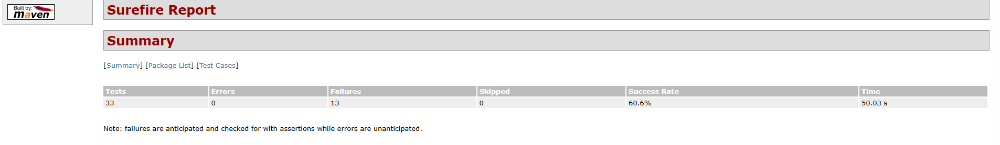

# Restful-Booker API Automation

> **Quick Language Switch:**  
> [🇬🇧 English Version](#-english-version) &nbsp;|&nbsp; [🇬🇷 Ελληνική Έκδοση](#-ελληνική-έκδοση)

---

## 🇬🇧 English Version

An automated **REST API test suite** for the public [Restful-Booker](https://restful-booker.herokuapp.com) service, written in **Java** with **REST Assured** and **JUnit 5**. It covers the whole booking lifecycle (health check, authentication, create, read, update, partial update, delete) with positive and negative scenarios, supports **tag-based test selection**, and runs in a **Jenkins pipeline** that publishes HTML and JUnit reports.

### Bugs Found
- `POST /booking` returns `500` instead of `400` when `lastname` is missing or `null`.
- `POST /booking` returns `500` instead of `400` when `firstname` is `null`.
- `POST /booking` accepts a negative `totalprice`.
- `POST /booking` accepts a `checkin` date after the `checkout` date.
- `POST /booking` accepts the `YYYY_MM_DD` date format and stores it as `0NaN-aN-aN`.
- `POST /booking` accepts a `null` `additionalneeds` (to be confirmed if it is optional).
- `POST /booking` silently converts `YYYY/MM/DD` dates to `YYYY-MM-DD`.
- `PATCH /booking/{id}` allows setting `checkin` after `checkout`.
- `DELETE /booking/{id}` returns `201 Created` instead of `200`/`204`.
- `DELETE /booking/{id}` intermittently rejects a valid `Cookie` token with `403`.
- `GET /booking?checkin=` does not return the booking whose check-in equals the given date.
- `GET /ping` returns `201 Created` instead of `200 OK`.
- `POST /auth` returns `200` instead of `401` for bad credentials.

### Test Report



The full HTML report is available in [`docs/surefire-report/`](docs/surefire-report/) (download the folder and open `surefire-report.html` in a browser).

### Tech Stack
- **Java** + **Maven** – build and test execution
- **REST Assured 5.5.0** – fluent HTTP requests and response assertions
- **JUnit 5 (5.10.2)** – test framework (`@Tag`, `@DisplayName`, `@Nested`, lifecycle hooks)
- **Jackson 2.17.0** – JSON serialization of request models (used implicitly by REST Assured)
- **Datafaker 2.4.0** – random test data (e.g. invalid credentials)
- **Maven Surefire 3.2.5** + **Surefire Report** + **Maven Site** – test runner and HTML reports
- **Jenkins** – CI pipeline (`Jenkinsfile`)

### Project Structure

```text
RestfulBookerApiAutomation
├── Jenkinsfile                     # CI pipeline
├── pom.xml
├── LICENSE                         # MIT
└── src/test/java/com/booker
    ├── models/                     # POJOs: Booking, BookingDates, AuthCredentials
    └── tests/
        ├── HealthCheckTest.java
        ├── CreateTokenTest.java
        ├── CreateBookingTest.java
        ├── GetBookingTest.java
        ├── UpdateBookingTest.java
        ├── PartialUpdateBookingTest.java
        └── DeleteBookingTest.java
```

### What Is Covered

| Test class | Tags | Endpoint | Scenarios |
|---|---|---|---|
| `HealthCheckTest` | `smoke`, `HealthCheck` | `GET /ping` | Server is online |
| `CreateTokenTest` | `smoke`, `CreateToken` | `POST /auth` | Valid credentials return a token; random credentials return `Bad credentials` |
| `CreateBookingTest` | `CreateBooking` | `POST /booking` | Valid booking, alternative date formats, invalid data (missing/null fields, negative price, check-in after check-out) → `400` |
| `GetBookingTest` | `GetBooking` | `GET /booking`, `GET /booking/{id}` | List IDs, get by dynamic ID with field-type checks, filter by first name, last name, check-in and check-out |
| `UpdateBookingTest` | `UpdateBooking` | `PUT /booking/{id}` | Update with Basic Auth, Cookie token, or both; the result is verified afterwards |
| `PartialUpdateBookingTest` | `PartialUpdateBooking` | `PATCH /booking/{id}` | Partial updates (first name only, dates only, one date), empty body, invalid dates |
| `DeleteBookingTest` | `DeleteBooking` | `DELETE /booking/{id}` | Delete with Cookie token or Basic Auth, then confirm `404` |

### Key Highlights
- **Tag-based execution** – every class has its own `@Tag`, and the fast `smoke` group (health check + token) can be run on its own.
- **Dynamic test data** – booking IDs are fetched from the API at runtime instead of being hardcoded.
- **Two authentication styles** – token via `Cookie: token=...` and `Authorization: Basic`.
- **Typed request models** – POJOs serialized to JSON, so payloads stay readable.
- **Documented API quirks** – tests marked `(Defect-masking)` assert the behaviour the service actually returns (for example `201 Created` on delete, `200` on bad credentials).
- **Reports out of the box** – Surefire HTML report plus JUnit XML results.
- **Failures don't hide the report** – `testFailureIgnore=true` is set, so the build finishes and the reports are always produced.

> ℹ️ The tests run against a **live public API** shared by everyone. Data can change between runs and the service resets itself periodically, so an occasional failure is not always a bug in the tests.

### How to Run

#### Prerequisites
- **JDK 25** (the version used by the Jenkins job)
- **Maven 3.8+**
- Internet access to `https://restful-booker.herokuapp.com`

#### Option 1: Via Terminal / CLI (Recommended)

```bash
# Run all tests
mvn clean test

# Run one group by tag (smoke, HealthCheck, CreateToken, GetBooking, CreateBooking,
# UpdateBooking, PartialUpdateBooking, DeleteBooking)
mvn clean test -Dgroups=smoke

# Run a single test class / method
mvn test -Dtest=CreateBookingTest
mvn test -Dtest=GetBookingTest#getAllBookingsTest

# Run everything and generate the HTML report
mvn clean test site surefire-report:report-only
```

Results: `target/surefire-reports/` (XML/TXT) and `target/site/surefire-report.html` (HTML).

> Because of `testFailureIgnore=true`, Maven reports `BUILD SUCCESS` even when some tests fail. Check the summary or the report to see the real result.

#### Option 2: Via IDE (IntelliJ IDEA / Eclipse)
1. Open the project as a **Maven project** (select `pom.xml`) and set the Project SDK to **JDK 25**.
2. Right-click `src/test/java`, a test class, or a single test method.
3. Choose **Run Tests** (IntelliJ) or **Run As → JUnit Test** (Eclipse).

#### Option 3: Via Jenkins (CI)

The `Jenkinsfile` defines a pipeline that runs the suite and publishes the reports.

| Setting | Value |
|---|---|
| Job type | Parameterized Pipeline |
| Pipeline definition | Pipeline script from SCM (Git) |
| Repository | `https://github.com/jomarkis/RestfulBookerApiAutomation` |
| Branch | `*/main` |
| Tools | `Maven 3.8`, `JDK-25` (configured under *Manage Jenkins → Tools*) |

**Build parameter `TAGS`** (choice): `All tests` · `smoke` · `HealthCheck` · `CreateToken` · `GetBooking` · `CreateBooking` · `UpdateBooking` · `PartialUpdateBooking` · `DeleteBooking`

What the pipeline does:
1. Runs `mvn clean test site surefire-report:report-only -DtestFailureIgnore=true`.
2. If `TAGS` is anything other than `All tests`, it adds `-Dgroups="<TAGS>"` to run only that tag.
3. Publishes an **HTML report** (*Surefire Test Report*) and the **JUnit results** to the build page.

To run it: open the job → **Build with Parameters** → choose `TAGS` → **Build**.

> The pipeline uses the `bat` step, so it expects a **Windows agent**, and it needs the **HTML Publisher** and **JUnit** plugins.


<br>

---
---

<br>

## 🇬🇷 Ελληνική Έκδοση

Μια αυτοματοποιημένη **σουίτα δοκιμών REST API** για την δημόσια υπηρεσία [Restful-Booker](https://restful-booker.herokuapp.com), γραμμένη σε **Java** με **REST Assured** και **JUnit 5**. Καλύπτει ολόκληρο τον κύκλο ζωής μιας κράτησης (health check, authentication, δημιουργία, ανάγνωση, πλήρης ενημέρωση, μερική ενημέρωση, διαγραφή) με θετικά και αρνητικά σενάρια, υποστηρίζει **επιλογή tests με tags** και τρέχει σε **Jenkins pipeline** που δημοσιεύει αναφορές HTML και JUnit.

### Bugs που Βρέθηκαν
- Το `POST /booking` επιστρέφει `500` αντί για `400` όταν το `lastname` λείπει ή είναι `null`.
- Το `POST /booking` επιστρέφει `500` αντί για `400` όταν το `firstname` είναι `null`.
- Το `POST /booking` δέχεται αρνητικό `totalprice`.
- Το `POST /booking` δέχεται `checkin` μετά το `checkout`.
- Το `POST /booking` δέχεται τη μορφή ημερομηνίας `YYYY_MM_DD` και την αποθηκεύει ως `0NaN-aN-aN`.
- Το `POST /booking` δέχεται `null` `additionalneeds` (να επιβεβαιωθεί αν είναι προαιρετικό).
- Το `POST /booking` μετατρέπει σιωπηλά τις ημερομηνίες `YYYY/MM/DD` σε `YYYY-MM-DD`.
- Το `PATCH /booking/{id}` επιτρέπει `checkin` μετά το `checkout`.
- Το `DELETE /booking/{id}` επιστρέφει `201 Created` αντί για `200`/`204`.
- Το `DELETE /booking/{id}` απορρίπτει κατά διαστήματα έγκυρο `Cookie` token με `403`.
- Το `GET /booking?checkin=` δεν επιστρέφει την κράτηση με check-in ίσο με την ημερομηνία του φίλτρου.
- Το `GET /ping` επιστρέφει `201 Created` αντί για `200 OK`.
- Το `POST /auth` επιστρέφει `200` αντί για `401` για λάθος credentials.

### Αναφορά Δοκιμών


Η πλήρης HTML αναφορά βρίσκεται στο [`docs/surefire-report/`](docs/surefire-report/) (κατέβασε τον φάκελο και άνοιξε το `surefire-report.html` σε browser).

### Τεχνολογίες
- **Java** + **Maven** – build και εκτέλεση των tests
- **REST Assured 5.5.0** – HTTP requests και assertions στις απαντήσεις
- **JUnit 5 (5.10.2)** – test framework (`@Tag`, `@DisplayName`, `@Nested`, lifecycle hooks)
- **Jackson 2.17.0** – σειριοποίηση των request models σε JSON (χρησιμοποιείται έμμεσα από το REST Assured)
- **Datafaker 2.4.0** – τυχαία δεδομένα δοκιμών (π.χ. λάθος credentials)
- **Maven Surefire 3.2.5** + **Surefire Report** + **Maven Site** – εκτέλεση tests και HTML αναφορές
- **Jenkins** – CI pipeline (`Jenkinsfile`)

### Δομή Project

```text
RestfulBookerApiAutomation
├── Jenkinsfile                     # CI pipeline
├── pom.xml
├── LICENSE                         # MIT
└── src/test/java/com/booker
    ├── models/                     # POJOs: Booking, BookingDates, AuthCredentials
    └── tests/
        ├── HealthCheckTest.java
        ├── CreateTokenTest.java
        ├── CreateBookingTest.java
        ├── GetBookingTest.java
        ├── UpdateBookingTest.java
        ├── PartialUpdateBookingTest.java
        └── DeleteBookingTest.java
```

### Τι Καλύπτεται

| Κλάση test | Tags | Endpoint | Σενάρια |
|---|---|---|---|
| `HealthCheckTest` | `smoke`, `HealthCheck` | `GET /ping` | Ο server είναι online |
| `CreateTokenTest` | `smoke`, `CreateToken` | `POST /auth` | Σωστά credentials επιστρέφουν token· τυχαία credentials επιστρέφουν `Bad credentials` |
| `CreateBookingTest` | `CreateBooking` | `POST /booking` | Έγκυρη κράτηση, εναλλακτικές μορφές ημερομηνίας, άκυρα δεδομένα (λείπουν/null πεδία, αρνητική τιμή, check-in μετά το check-out) → `400` |
| `GetBookingTest` | `GetBooking` | `GET /booking`, `GET /booking/{id}` | Λίστα IDs, ανάκτηση με δυναμικό ID και έλεγχο τύπων πεδίων, φιλτράρισμα με όνομα, επώνυμο, check-in και check-out |
| `UpdateBookingTest` | `UpdateBooking` | `PUT /booking/{id}` | Ενημέρωση με Basic Auth, Cookie token ή και τα δύο· το αποτέλεσμα επαληθεύεται μετά |
| `PartialUpdateBookingTest` | `PartialUpdateBooking` | `PATCH /booking/{id}` | Μερικές ενημερώσεις (μόνο όνομα, μόνο ημερομηνίες, μία ημερομηνία), κενό body, άκυρες ημερομηνίες |
| `DeleteBookingTest` | `DeleteBooking` | `DELETE /booking/{id}` | Διαγραφή με Cookie token ή Basic Auth και επιβεβαίωση `404` |

### Βασικά Χαρακτηριστικά
- **Εκτέλεση με tags** – κάθε κλάση έχει δικό της `@Tag` και η γρήγορη ομάδα `smoke` (health check + token) τρέχει ξεχωριστά.
- **Δυναμικά δεδομένα** – τα IDs των κρατήσεων ανακτώνται από το API κατά την εκτέλεση, δεν είναι hardcoded.
- **Δύο τρόποι authentication** – token μέσω `Cookie: token=...` και `Authorization: Basic`.
- **Typed request models** – POJOs που σειριοποιούνται σε JSON, ώστε τα payloads να είναι ευανάγνωστα.
- **Τεκμηριωμένες ιδιαιτερότητες του API** – τα tests με την ένδειξη `(Defect-masking)` ελέγχουν τη συμπεριφορά που επιστρέφει πραγματικά η υπηρεσία (π.χ. `201 Created` στη διαγραφή, `200` σε λάθος credentials).
- **Αναφορές έτοιμες** – HTML αναφορά Surefire και JUnit XML αποτελέσματα.
- **Οι αποτυχίες δεν κρύβουν την αναφορά** – έχει οριστεί `testFailureIgnore=true`, οπότε το build ολοκληρώνεται και οι αναφορές παράγονται πάντα.

> ℹ️ Τα tests τρέχουν σε ένα **ζωντανό δημόσιο API** που το μοιράζονται όλοι. Τα δεδομένα μπορεί να αλλάξουν μεταξύ εκτελέσεων και η υπηρεσία κάνει reset περιοδικά, οπότε μια σποραδική αποτυχία δεν σημαίνει πάντα πρόβλημα στα tests.

### Πώς να Τρέξετε

#### Προαπαιτούμενα
- **JDK 25** (η έκδοση που χρησιμοποιεί το Jenkins job)
- **Maven 3.8+**
- Πρόσβαση στο internet για το `https://restful-booker.herokuapp.com`

#### Επιλογή 1: Μέσω Terminal / CLI (Προτεινόμενη)

```bash
# Εκτέλεση όλων των tests
mvn clean test

# Εκτέλεση μίας ομάδας με tag (smoke, HealthCheck, CreateToken, GetBooking, CreateBooking,
# UpdateBooking, PartialUpdateBooking, DeleteBooking)
mvn clean test -Dgroups=smoke

# Εκτέλεση μίας κλάσης / μίας μεθόδου
mvn test -Dtest=CreateBookingTest
mvn test -Dtest=GetBookingTest#getAllBookingsTest

# Εκτέλεση όλων και δημιουργία HTML αναφοράς
mvn clean test site surefire-report:report-only
```

Αποτελέσματα: `target/surefire-reports/` (XML/TXT) και `target/site/surefire-report.html` (HTML).

> Λόγω του `testFailureIgnore=true`, το Maven δείχνει `BUILD SUCCESS` ακόμα και όταν αποτυγχάνουν tests. Δες τη σύνοψη ή την αναφορά για το πραγματικό αποτέλεσμα.

#### Επιλογή 2: Μέσω IDE (IntelliJ IDEA / Eclipse)
1. Ανοίξτε το project ως **Maven project** (επιλέξτε το `pom.xml`) και ορίστε Project SDK **JDK 25**.
2. Δεξί κλικ στο `src/test/java`, σε μια κλάση test ή σε μία μέθοδο.
3. Επιλέξτε **Run Tests** (IntelliJ) ή **Run As → JUnit Test** (Eclipse).

#### Επιλογή 3: Μέσω Jenkins (CI)

Το `Jenkinsfile` ορίζει ένα pipeline που τρέχει τη σουίτα και δημοσιεύει τις αναφορές.

| Ρύθμιση | Τιμή |
|---|---|
| Τύπος job | Parameterized Pipeline |
| Ορισμός pipeline | Pipeline script from SCM (Git) |
| Repository | `https://github.com/jomarkis/RestfulBookerApiAutomation` |
| Branch | `*/main` |
| Tools | `Maven 3.8`, `JDK-25` (ρυθμίζονται στο *Manage Jenkins → Tools*) |

**Παράμετρος build `TAGS`** (choice): `All tests` · `smoke` · `HealthCheck` · `CreateToken` · `GetBooking` · `CreateBooking` · `UpdateBooking` · `PartialUpdateBooking` · `DeleteBooking`

Τι κάνει το pipeline:
1. Τρέχει `mvn clean test site surefire-report:report-only -DtestFailureIgnore=true`.
2. Αν το `TAGS` δεν είναι `All tests`, προσθέτει `-Dgroups="<TAGS>"` ώστε να τρέξει μόνο αυτό το tag.
3. Δημοσιεύει **HTML αναφορά** (*Surefire Test Report*) και τα **αποτελέσματα JUnit** στη σελίδα του build.

Για εκτέλεση: άνοιξε το job → **Build with Parameters** → διάλεξε `TAGS` → **Build**.

> Το pipeline χρησιμοποιεί το βήμα `bat`, άρα απαιτεί **Windows agent**, και χρειάζεται τα plugins **HTML Publisher** και **JUnit**.
